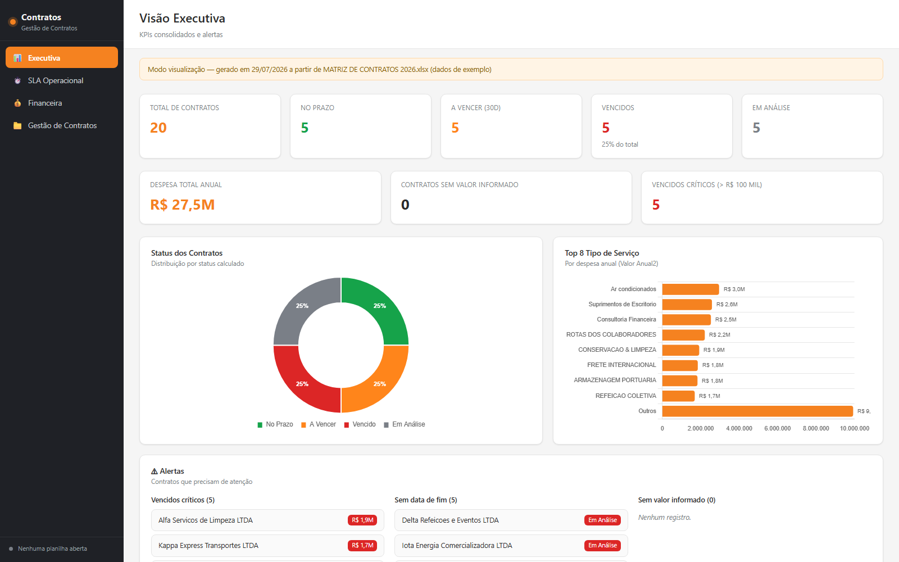
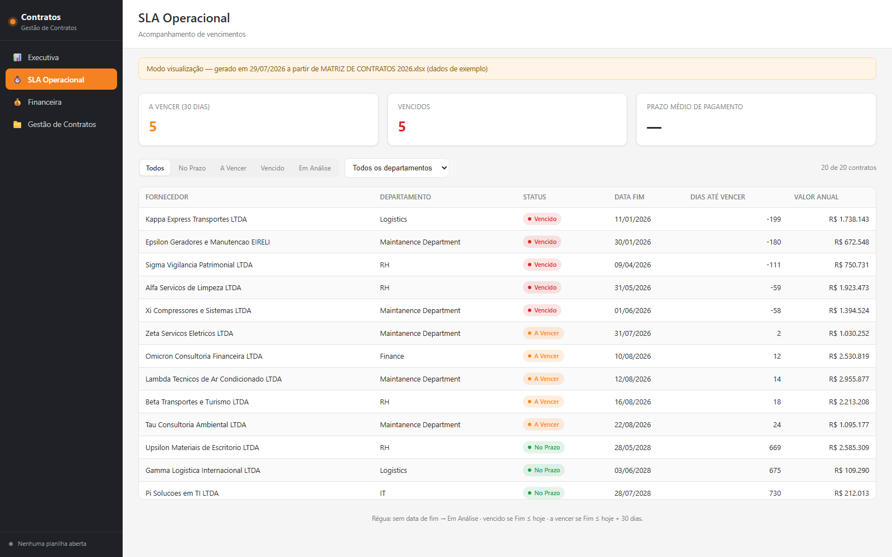
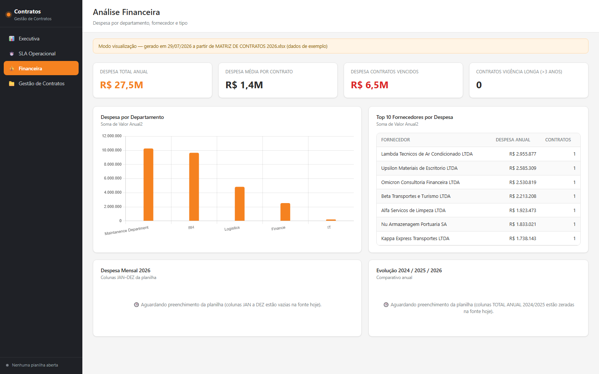
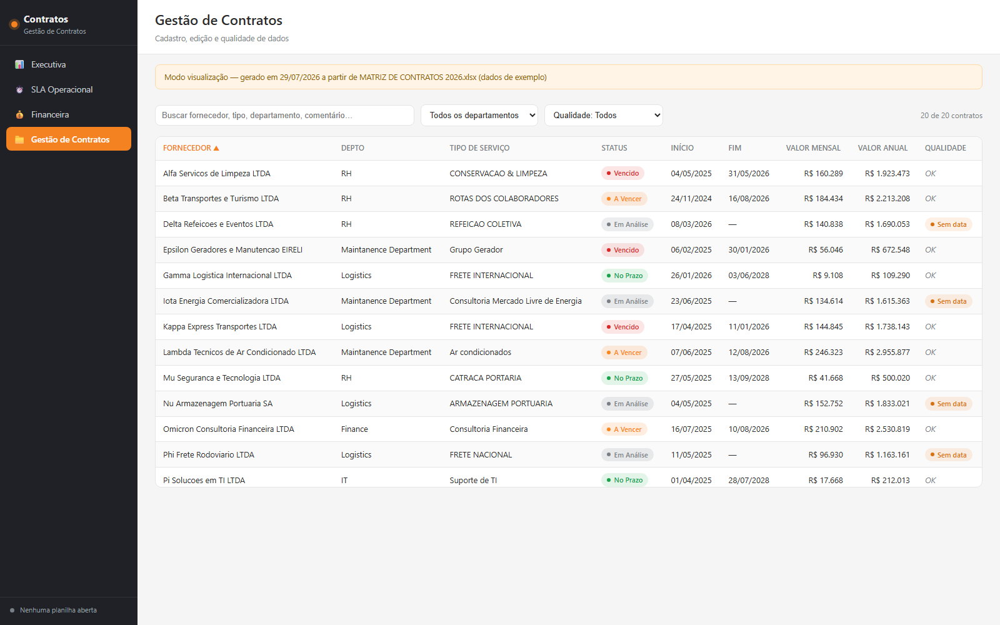

# Dashboard de Gestão de Contratos


Aplicação **client-side, single-file, sem instalação e sem servidor** que
lê e edita uma planilha `.xlsx` de contratos **direto no navegador**, sem
nunca enviar os dados para fora da máquina do usuário.



> Os dados mostrados nas capturas de tela e na planilha de exemplo deste
> repositório são **100% fictícios**, gerados só para demonstração.

## Objetivo

Times que gerenciam dezenas ou centenas de contratos de fornecedores
normalmente dependem de uma planilha "viva", mantida manualmente, sem uma
visão consolidada de vencimentos, risco financeiro e qualidade dos dados.
Este dashboard cobre esse gap **sem exigir infraestrutura**: qualquer
pessoa com Microsoft Edge ou Google Chrome consegue abrir a planilha,
visualizar KPIs, cadastrar/editar/excluir contratos e gerar um relatório
estático para compartilhar — tudo a partir de um único arquivo `.xlsx` e
um único arquivo `.html`.

## Principais funcionalidades

- **5 telas**: Home (apresentação com o fundo da empresa), Visão Executiva,
  Status do contrato, Financeiro e Gestão de Contratos.
- **KPIs calculados** em tempo real a partir da planilha: total de
  contratos, distribuição por status, despesa total em R$ e em US$,
  despesa média, vigência longa, prazo médio de pagamento, entre outros.
- **Status automático**: calculado a partir da data de fim a cada
  carregamento (No Prazo / A Vencer / Vencido / Em Análise), com opção de
  override manual por contrato quando necessário.
- **Gasto mensal em R$ e em dólar**: cada mês tem a sua própria cotação na
  planilha, e o valor em dólar do mês é sempre `mês R$ ÷ cotação do mês`.
- **Vários exercícios lado a lado**: cada ano ocupa um bloco de 26 colunas na
  planilha (12 meses em R$, 12 em dólar e o `Total Faturado <ano>` em R$ e US$).
  Um seletor na barra superior troca o exercício e **todas** as telas
  acompanham. Anos novos entram pelos dois lados: o botão **"+ Inserir ano"**
  cria o bloco na planilha, e um ano digitado à mão no Excel (`JAN 2027 R$`…)
  é reconhecido sozinho na próxima abertura.
- **Modo "planilha por ano" (V1.6.0)**: se ao lado do `Dashboard_Contratos.html`
  houver uma `MATRIZ DE CONTRATOS <ano>.xlsx` por exercício, o seletor de ano
  troca de **planilha** (em vez de bloco interno) — o seletor mostra só os anos
  com arquivo, e o Salvar grava somente na planilha do ano em exibição.
- **Gráficos** (Chart.js): distribuição de status (donut com o total no
  centro), ranking de prestador de serviço, despesa por departamento, top
  fornecedores e gasto mês a mês (R$ e US$) com recorte por ano, empresa e
  tipo de serviço.
- **CRUD completo de contratos**: cadastro, edição e exclusão via
  formulário modal — incluindo os 12 valores mensais —, com busca (sem
  distinção de acento), filtro por departamento e ordenação de colunas.
- **Leitura/escrita direta do `.xlsx`** via File System Access API — sem
  upload, sem conversão, sem servidor intermediário. Apenas as colunas
  gerenciadas pelo app são tocadas; todas as outras abas/colunas da
  planilha são preservadas intactas.
- **A planilha continua viva**: as colunas em dólar e os totais anuais são
  gravados como **fórmula** (`=SEERRO(...)`, `=SOMA(...)`), não como número
  fixo — mudou a cotação no Excel, tudo recalcula sozinho.
- **Salvar também formata a planilha**: cabeçalho destacado, painel congelado,
  autofiltro, larguras legíveis, `R$`/`US$` e datas `dd/mm/aaaa`, zebra nas
  linhas, nenhuma linha oculta — e as colunas mensais ficam num grupo recolhível
  **por ano**, então o arquivo abre com os campos fixos e os totais, e você
  expande no `[+]` só o exercício que for lançar. É idempotente: a planilha se
  ajeita no primeiro salvamento e não degrada nos seguintes.
- **Backup automático** (1 cópia do estado anterior) a cada salvamento.
- **Snapshot standalone**: gera um HTML autocontido (dados embutidos,
  sem dependências externas) para compartilhar por e-mail ou rede — quem
  abre só visualiza, sem nenhum controle de edição. O botão **"Exportar
  HTML do dia"** gera uma cópia datada, para enviar à diretoria sem
  sobrescrever o snapshot corrente.
- **Sidebar retrátil** (só ícones) e **modo tela cheia** (`Esc` para sair),
  para apresentar o dashboard em telas menores ou em projeção.
- **100% offline**: nenhuma dependência é baixada em tempo de execução
  (sem CDN); tudo que o navegador precisa já está em `assets/`.

## Screenshots

| Visão Executiva | SLA Operacional |
|---|---|
|  |  |

| Análise Financeira | Gestão de Contratos |
|---|---|
|  |  |

## Arquitetura

SPA vanilla JS (sem framework, sem bundler) dividida em módulos por
responsabilidade: `Regras` (lógica de negócio pura), `ExcelIO`
(leitura/escrita/formatação do `.xlsx` via File System Access API + ExcelJS) e a
camada de estado/renderização/CRUD em `app.js`. O mesmo código roda em dois
modos — **live** (edição via arquivo local) e **snapshot** (visualização
estática, dados embutidos) — sem duplicação de lógica.

Ver [`docs/ARQUITETURA.md`](docs/ARQUITETURA.md) para o fluxo de dados
completo, o racional de não ter backend e os tradeoffs da File System
Access API, e [`docs/DECISOES.md`](docs/DECISOES.md) para decisões
técnicas pontuais (ex.: mitigação de injeção de script na geração do
snapshot).

## Tecnologias

| Camada | Tecnologia |
|---|---|
| UI | HTML5 + CSS3 (design system próprio, sem framework) |
| Lógica | JavaScript (ES5-style, módulos IIFE, sem bundler) |
| Planilha | [ExcelJS](https://github.com/exceljs/exceljs) (`exceljs.min.js`), vendorizado |
| Gráficos | [Chart.js](https://www.chartjs.org/) v4.4.0 + [chartjs-plugin-datalabels](https://chartjs-plugin-datalabels.netlify.app/) v2.2.0, vendorizados |
| Leitura/escrita de arquivo | [File System Access API](https://developer.mozilla.org/en-US/docs/Web/API/File_System_API) (Chromium: Edge/Chrome) |
| Build auxiliar | Python 3 (`build_snapshot_template.py`), só para regenerar o molde do snapshot |

Todas as bibliotecas de terceiros são MIT-licensed e ficam vendorizadas em
`assets/` — nada é baixado de CDN em runtime.

## Estrutura do projeto

```
Código/
├── Dashboard_Contratos.html      ← abrir este arquivo para usar o app (navegador)
├── dados/exemplo_simulado.xlsx   ← planilha de exemplo (dados fictícios); copie para a raiz como
│                                    "MATRIZ DE CONTRATOS 2026.xlsx" para usar o app com dados
├── build_snapshot_template.py    ← regenera assets/snapshot-template.js
├── assets/
│   ├── theme.css                 ← design system (paleta, tipografia, componentes)
│   ├── regras.js                 ← lógica de negócio (status, 14 KPIs, normalizações)
│   ├── excel.js                  ← leitura/escrita (File System Access API + ExcelJS)
│   ├── app.js                    ← estado, navegação, filtros, gráficos, CRUD, snapshot
│   ├── exceljs.min.js            ← ExcelJS vendorizado (lê, grava e formata o .xlsx)
│   ├── chart.umd.min.js          ← Chart.js vendorizado
│   ├── chartjs-plugin-datalabels.min.js
│   └── snapshot-template.js      ← gerado por build_snapshot_template.py (não editar à mão)
└── docs/
    ├── ARQUITETURA.md            ← fluxo de dados, decisões de arquitetura
    ├── DECISOES.md               ← decisões técnicas pontuais (estilo ADR)
    └── screenshots/
```

## Como instalar

Não há instalação nem dependências para baixar. Clone o repositório:

```bash
git clone https://github.com/eholuwi/gest-o-de-contratos.git
cd gest-o-de-contratos
```

## Como executar — versão navegador (HTML)

1. Use **Microsoft Edge ou Google Chrome** (obrigatório para editar — é a
   única família de navegador com suporte à File System Access API, que
   grava direto no arquivo). Em outro navegador o dashboard abre e mostra
   os dados, mas os botões de editar ficam ocultos.
2. Dê duplo clique em **`Dashboard_Contratos.html`**. (Obs.: direto de
   `file://` o Chrome não expõe o seletor de pasta da File System Access
   API — "Abrir planilha" depende de servir a pasta via HTTP, ex.: `python
   -m http.server` na pasta, ou da cópia publicada numa pasta de rede.)
3. Clique em **📂 Abrir planilha** na barra lateral.
4. Selecione a **pasta** do repositório (não o arquivo — a pasta, para que
   o navegador também consiga escrever o backup e o snapshot). O
   Chrome/Edge vai pedir permissão de leitura/escrita nessa pasta uma vez;
   aceite.
   > A planilha de exemplo vem como `dados/exemplo_simulado.xlsx` (fora do
   > padrão de nome). Copie-a para a raiz do repositório como
   > `MATRIZ DE CONTRATOS 2026.xlsx` — é esse nome que o app procura.
5. Navegue pelas 4 páginas e explore os dados de exemplo.

## Como usar

- **O seletor "Exercício" na barra superior manda em tudo.** Ele define de qual
  ano saem os KPIs, os rankings, os gráficos e as colunas mensais da tabela —
  as quatro telas falam sempre do mesmo exercício.
- Cadastre, edite ou exclua contratos na página **Gestão de Contratos**.
  A tabela é o espelho da planilha, incluindo as 24 colunas mensais do
  exercício selecionado (`JAN 2026 R$` / `JAN 2026 $` … `DEZ 2026 $`) — role na
  horizontal; a Razão Social fica fixa à esquerda.
- O **status é calculado automaticamente** a partir da data de Fim, toda
  vez que a página carrega. O campo "Status Manual" no formulário existe
  só para forçar um status diferente do calculado em casos excepcionais —
  deixe em "Automático" na maioria dos casos.
- **Os valores mensais em R$** podem ser preenchidos na planilha (por
  PROCV) ou pelo formulário do app, que traz um bloco de 12 meses por ano. Os
  valores em dólar **não se digitam**: são derivados da cotação daquele mês.
- **A cotação de cada mês fica na planilha**, na linha 2 da coluna "MÊS $"
  correspondente (o rótulo "cotaçao do dolar <mês> <ano>" está na linha 1). O
  app só lê — para atualizar, edite no Excel. A página **Financeira** mostra as
  12 cotações do exercício selecionado.
- **Para começar um ano novo**, use **"+ Inserir ano"** na página Gestão: o app
  cria as 26 colunas daquele exercício (12 meses em R$, 12 em US$ e o Total
  Faturado em R$ e US$) mais os rótulos de cotação, e o "Salvar" grava na
  planilha. Se preferir criar as colunas direto no Excel, siga o mesmo padrão de
  nome (`JAN 2027 R$`, `JAN 2027 $`, …) — o app reconhece na próxima abertura.

### Base do Power BI (V1.7.0)

Se a pasta escolhida em "Abrir planilha", ou qualquer subpasta dela, tiver as
planilhas do Power BI (`MATRIZ DE POWERBI CONTRATOS <ano>.xlsx`, uma por ano),
o app trabalha **nelas**. É a mesma base do Power BI, com os mesmos números.

- **Cada ano é um arquivo.** O seletor "Exercício" troca de planilha, e o
  "Salvar" grava só na do ano em exibição.
- **O Código Fornecedor é a 1ª coluna** da tabela de Gestão. O formulário
  também tem "Nome curto", o rótulo do contrato nos gráficos.
- **O status conta da data de posição da planilha:** 31/12 no ano fechado,
  e o dia do último recálculo no Excel no ano corrente. A barra de ano mostra
  "Posição em …".
- **Depois de salvar pelo app, abra a planilha no Excel e salve.** O app grava
  só os valores digitados, e quem recalcula status, dólar e indicadores é o
  Excel. Até alguém abrir e salvar, o Power BI avisa em vermelho que a
  planilha não foi recalculada.
- **O app não salva por cima de ninguém.** Ele recusa salvar se a planilha
  estiver aberta no Excel ou se alguém a salvou depois que você abriu.
- **Saving (V1.9.0).** Se a planilha tiver a aba Saving, a Executiva mostra os BIDs e
  o saving mês a mês. A tela Gestão tem uma seção para incluir, editar e excluir
  saving, que grava pelo mesmo "Salvar".
  - O saving é lançado em R$ por mês; um total sem detalhe mensal vai à parte.
  - O US$ sai da cotação de cada mês; o total sem mês usa a média das cotações do ano.
- **Ano novo não se cria pelo app:** na planilha do ano anterior, faça
  "Salvar como" no Excel, com o ano no nome, como manda a aba "Como
  atualizar" da planilha.

## Como gerar o dashboard (snapshot)

Clique em **💾 Salvar**. Isso faz três coisas de uma vez:

1. grava as alterações de volta no `.xlsx` principal;
2. atualiza o `.backup.xlsx` (cópia de segurança, sempre com o estado
   *anterior* ao salvamento — não é histórico, é 1 cópia só, sobrescrita a
   cada vez);
3. gera/atualiza `Dashboard_Contratos_snapshot.html` na mesma pasta — esse
   arquivo é standalone (sem dependências externas) e pode ser anexado em
   e-mail ou publicado numa rede interna. Quem abrir só visualiza; não há
   nenhum botão de edição.

Para mandar uma versão **datada** (sem sobrescrever o snapshot corrente),
use **⬇ Exportar HTML do dia** — gera `Dashboard_Contratos_AAAA-MM-DD.html`
na mesma pasta da planilha. É o mesmo HTML standalone, com a data no nome.

## Como atualizar

```bash
git pull
```

Se você alterar `theme.css`, `regras.js`, `app.js` ou a estrutura de
`Dashboard_Contratos.html`, **reexecute**:

```bash
python build_snapshot_template.py
```

Isso regenera `assets/snapshot-template.js`, que embute uma cópia em
base64 desses arquivos para que o botão "Salvar" consiga montar o snapshot
standalone. Se você esquecer, o app continua funcionando normalmente — só
o *snapshot* gerado ficará com uma versão desatualizada da interface (os
dados sempre saem atualizados; é só o "molde" visual que fica velho).

## Limitações conhecidas

- **Não há instalação nem versão desktop** — a entrega é `Dashboard_Contratos.html` + `assets/` + a planilha. Rode num servidor HTTP simples (ex.: `python -m http.server`) ou abra uma cópia publicada em pasta de rede.
- **Só funciona para editar em Edge/Chrome** (File System Access API). Em
  Firefox/Safari a visualização funciona, mas os botões Abrir/Salvar ficam
  ocultos e um aviso aparece no topo.
- **Um editor por vez, por decisão de produto.** No layout antigo não há
  trava de arquivo. Na base do Power BI, o "Salvar" recusa gravar se a
  planilha estiver aberta no Excel ou se mudou desde que foi aberta. Ainda
  assim, recusa não é mescla: quem salvou depois refaz as alterações. Ver
  [`docs/ARQUITETURA.md`](docs/ARQUITETURA.md).
- **Backup é 1 cópia só**, sobrescrita a cada "Salvar" — não é histórico.
  Não há como voltar duas versões atrás.
- **Sem trilha de auditoria** — o app mostra só o estado atual, não quem
  mudou o quê e quando.
- **As cotações mensais são só de leitura no app** — para atualizar a
  cotação de um mês, edite a linha 2 da planilha no Excel. Sem cotação, a
  coluna em dólar daquele mês fica em branco (é o `=SEERRO(...)` fazendo o
  seu papel), e não zerada.
- **Excluir contrato não remove a linha física da planilha** — limpa os
  campos gerenciados daquela linha, para não desalinhar colunas não
  gerenciadas nas linhas vizinhas. Ver [`docs/DECISOES.md`](docs/DECISOES.md).
- **Fluxo de abrir/editar/salvar via File System Access API depende de
  gesto real do usuário** no seletor de pasta do navegador — não é
  automatizável em testes headless tradicionais.

## Roadmap / Funcionalidades futuras

- [ ] Integração com ERP para sincronização automática de contratos.
- [ ] Alertas por e-mail para contratos próximos do vencimento.
- [ ] Histórico de versões (além do backup de 1 cópia atual).
- [ ] Trilha de auditoria (quem alterou o quê e quando).

## Licença

Distribuído sob a licença [MIT](LICENSE).

## Autor

**eholuwi** — [github.com/eholuwi](https://github.com/eholuwi)

## Contato

Dúvidas, sugestões ou bugs: abra uma [issue](https://github.com/eholuwi/gest-o-de-contratos/issues).
